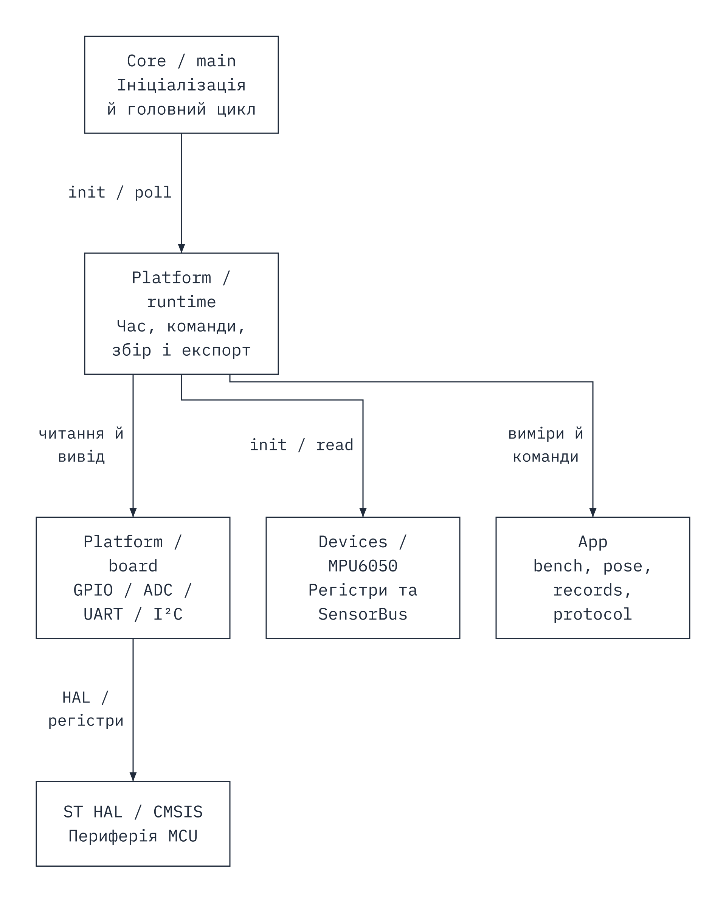

# Архітектура LightBench

App не залежить від HAL, GPIO або I²C. runtime поєднує дані драйвера та ADC з прикладною моделлю. make check перевіряє напрям залежностей.

Діаграма Flowcraft показує залежності модулів стрілкою від споживача до залежності. Core/main викликає runtime; runtime використовує board, MPU та App; board звертається до HAL. Це огляд модулів, а не повний граф кожного виклику. Core також ініціалізує HAL, а MPU отримує SensorBus із callback-функціями board. [Редагований граф](figures/components.stategraph.json) і [SVG](figures/components.svg).

[Алгоритм перевірки пари](figures/observation.png) є абстракцією правил bench_observation. Доступність каналів згрупована для читання; вихідний C-код лишається джерелом точного порядку перевірок.

LightSample і PoseSample оновлюються незалежно, зберігають завершення читання. bench_light/bench_pose рахують статистики активної серії, але останні дані доступні й у stopped для selftest. Натискання після debounce формує ReferencePoint з уже завершених вимірів. Читання заради точки не запускається. Прапорці розрізняють помилку каналу, старість, skew і непридатний вектор.

Кільце 64×28 байтів і сталий знімок 64×28 байтів разом займають 3584 байти. Канонічний формат CRC має п'ять uint32 і чотири uint16 у little-endian, без padding C. CRC32 IEEE, initial/final XOR 0xffffffff, polynomial 0xedb88320. CSV передає ці самі поля. CRC обчислюється по одному рядку під час експорту, щоб не блокувати збір підготовкою всього журналу. ISR не змінює записи.

Стан stopped → run за справного ADC → collecting → stop/ADC fault/3600000 мс → stopped. Новий run скидає лише статистики. Суми uint64 та окремі знаменники для ADC й придатних кутів. Gap означає інтервал >40 мс, failures невдалі спроби. Це різні метрики.

runtime_poll обробляє обмежену порцію UART, періодичні ADC та IMU, кнопку й один рядок export за наявності вільного TX. TX працює через IT-кільце. Status може чекати вже поставлені байти export, це обмеження перевіряється. I²C має спільний timeout 10 мс; короткі settle-інтервали порту не є навантаженням для картинки. HAL_Delay у циклі відсутній. NACK запускає IMU retry не частіше разу/с. ADC fault завершує серію.

## Ресурси та продовження

STM32C031C6 має 32 КіБ flash і 12 КіБ RAM. Лінкер обмежує код 28 КіБ, резервуючи 0x08007000..0x08007fff під FR-12 ЛР3. Фактичні секції та стекові кадри наведені у validation. Вони не доводять вимір піка стеку.

ЛР2 використовує SysTick, мс. Для ЛР3 кандидат TIM3 1 МГц із розширенням overflow і GPIO PA4/PB0/PB1. Підтримку таймера й reset потрібно перевірити окремим прототипом, DWT Cortex-M4 не переноситься на M0+. Flash, S1–S3, годинний прогін і повний baseline залишаються майбутньою роботою.

FreeRTOS може розділити збір, єдиного власника серії/точок та вивід/сховище. Черги передають початкові часи, критерії свіжості лишаються. Бюджет стеків задач потребує вимірів. ЛР5–6 невідомі.

## Походження

Core, HAL/CMSIS походять із дозволеного SP-Boilerplate та [stm32-hello-wokwi](https://github.com/wokwi/stm32-hello-wokwi), ліцензії збережені. board і MPU адаптовано зі своєї попередньої версії, без копіювання чужої прикладної частини. App і тести створено для часових потоків LightBench; profile/engine і перемикач власника відсутні. Vendor manifest фіксує залежності. Схема перевіряється окремо від host-тестів.
